<picture>
  <source media="(prefers-color-scheme: dark)" srcset="./assets/header-v2-dark.svg">
  <source media="(prefers-color-scheme: light)" srcset="./assets/header-v2-light.svg">
  
</picture>

  
  
  
  

 

I'm a **Lecturer in Computer Science & Engineering at [Shahjalal University of Science and Technology](https://www.sust.edu/)**, Sylhet.

- **Researcher.** I work on AI security: covert collusion between LLM agents, backdoors that survive fine-tuning, and detectors that catch them without drowning in false alarms.
- **Engineer.** At GatherGov I built autonomous LLM agents that run in production. They replaced hours of manual engineering and analyst work.
- **Problem solver.** Years of ICPC, 2,500+ solved problems and an Asia West Continent Final taught me to pick up unfamiliar things fast and ship solutions that are correct, not just plausible.

 

## ◆ Research

<table>
<tr>
<td width="50%" valign="top">

**Secret Collusion Detection in Multi-Agent LLM Systems** 
M.Sc. thesis · ongoing

An online, coalition-agnostic sequential detector for covert collusion among LLM agents — activation probes, subset inference and CUSUM / SPRT risk aggregation, evaluated at strict false-positive operating points on an extended NARCBENCH.

`multi-agent safety` `activation probes` `sequential testing`

</td>
<td width="50%" valign="top">

**Backdoor Persistence under Resource-Constrained Fine-Tuning** 
Co-Investigator · SUST Research Grant AS/2026/2/005

Do backdoors planted in open-weight LLMs (Llama-3-8B, Qwen2.5-7B, Gemma-2-9B) survive end-user LoRA, QLoRA and adapter tuning? Localizing them with activation patching and linear probes; benchmarking low-budget defences (BEEAR, SANDE, fine-pruning) on consumer GPUs.

`backdoors` `PEFT` `mechanistic interpretability`

</td>
</tr>
<tr>
<td width="50%" valign="top">

**Code-Mixed Bangla Hate Speech** 
Dataset + benchmark

188K code-mixed instances (81.3% F1, BanglaBERT), extended with 316K pure-Bangla instances (82.0% accuracy).

`low-resource NLP` `datasets`

</td>
<td width="50%" valign="top">

**ECG-Based Mortality Prediction** 
Deep learning for health

Neural Temporal Point Process modelling patient risk as a time-varying distribution from longitudinal ECG + clinical features — C-index 0.75, beating classical survival models.

`temporal point processes` `survival analysis`

</td>
</tr>
</table>

 

## ◆ Before academia

**Software Engineer · [GatherGov](https://www.linkedin.com/company/gathergov/)** Jun 2025 – Jul 2026 
VC-backed US startup that indexes local-government meetings nationwide for real-estate and capital-markets teams.

- Built two production **autonomous LLM agents** that replaced manual engineering and analyst workflows for government-data collection across **500+ websites**.
- **Scraper Agent** plans, writes, debugs and validates its own scrapers. Per-site work went from **1–4 dev-hours to a ~10-minute unattended run**.
- **Link Collection Agent** on Airflow (48 concurrent tasks) compressed **~190 analyst-hours into a single run**.

 

## ◆ Competitive programming

| ICPC | Codeforces | Solved | Hacker Cup |
| :---: | :---: | :---: | :---: |
| **Asia West Continent Finalist** · 2023 | **Expert** · max 1815 | **2,500+** problems | **#749** · 2024 |

Now on the other side of the problem statement — setter, judge and coordinator for **BUET IUPC 2026**, the **National High School Programming Contest 2026** (central coordinator), CUET, MU and SIU IUPCs, and coordinator of the **SUST Competitive Programming Training Camp**.

 

## ◆ Toolbox

<picture>
  <source media="(prefers-color-scheme: dark)" srcset="https://skillicons.dev/icons?i=py,pytorch,cpp,c,django,postgres,docker,aws,linux,git,latex&theme=dark&perline=11">
  <source media="(prefers-color-scheme: light)" srcset="https://skillicons.dev/icons?i=py,pytorch,cpp,c,django,postgres,docker,aws,linux,git,latex&theme=light&perline=11">
  
</picture>

`LangChain` `LangSmith` `Hugging Face` `LoRA / QLoRA` `Playwright` `Airflow` `Kafka`

 

---

  Interested in AI security research at SUST? My inbox is open — <a href="mailto:mainul3195@gmail.com">mainul3195@gmail.com</a>

